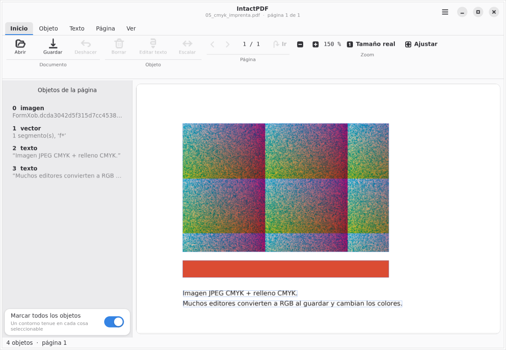
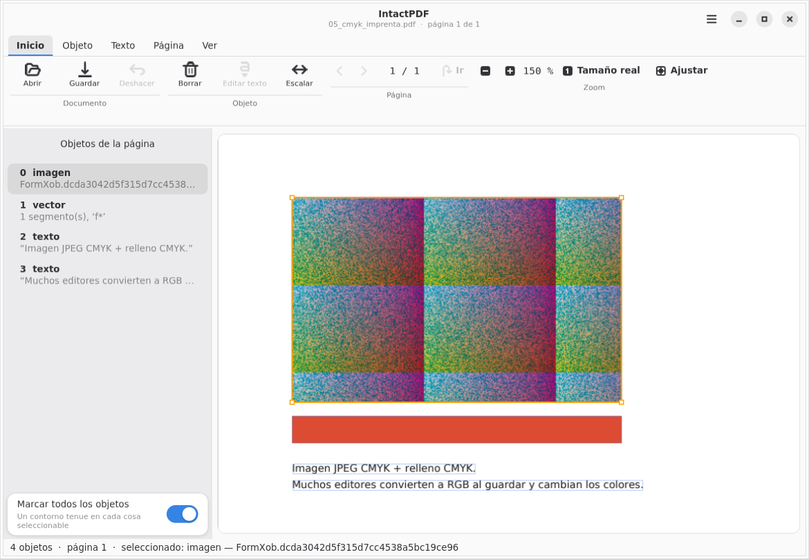
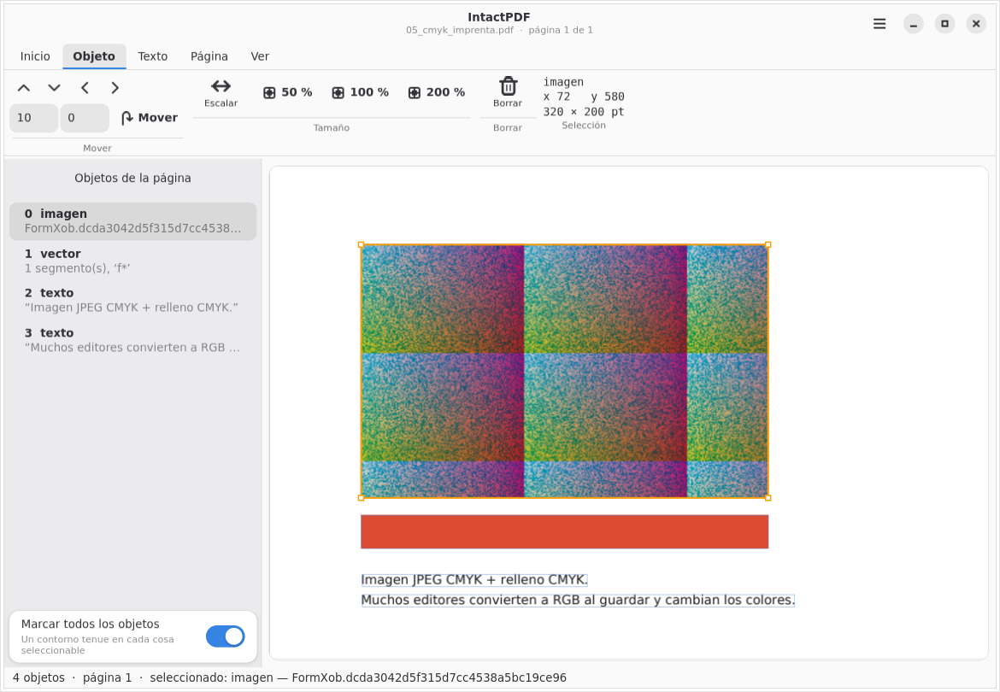
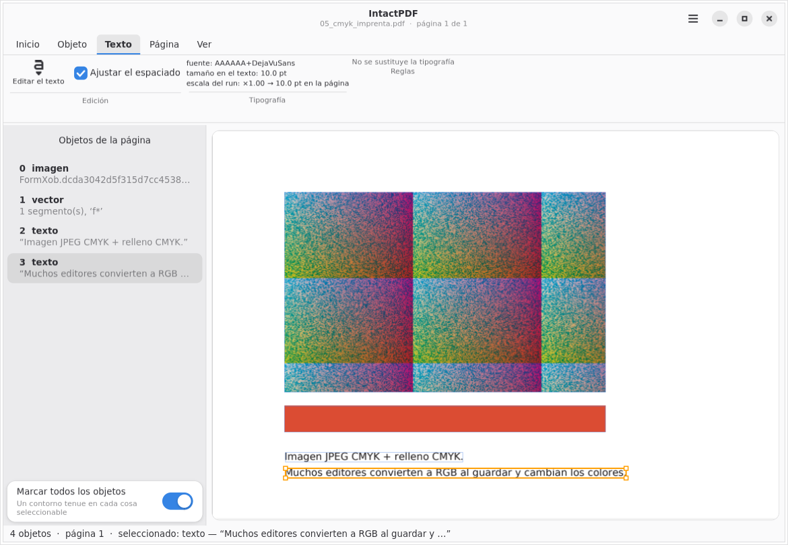
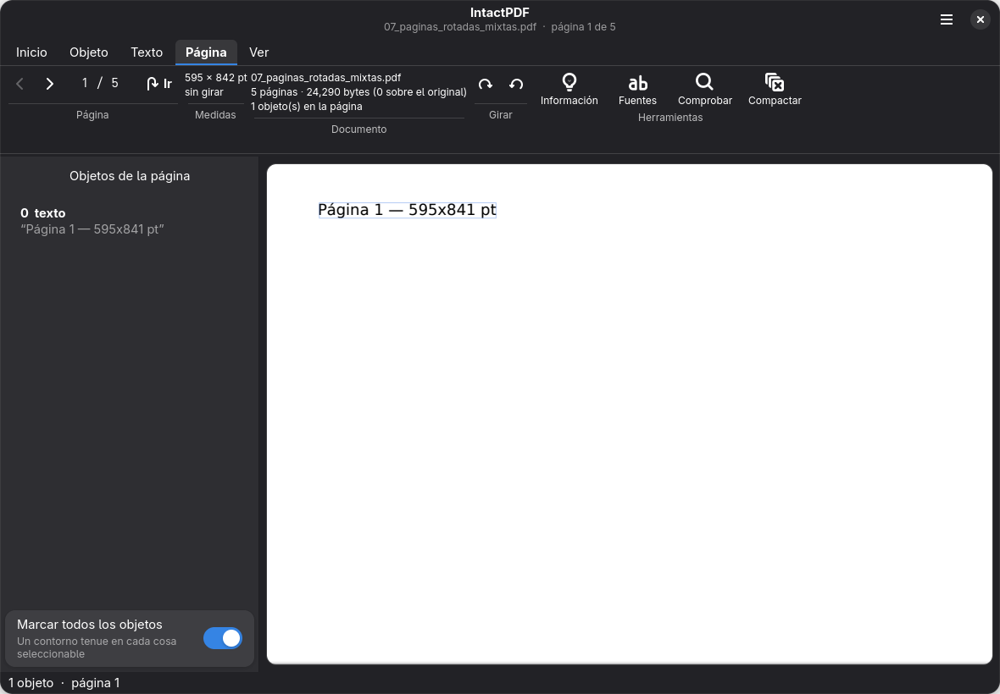
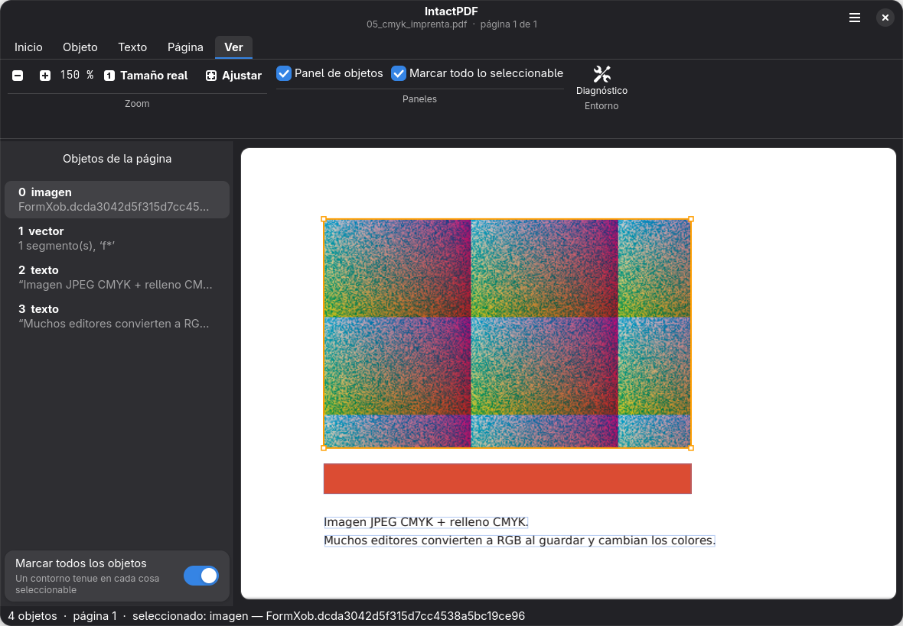
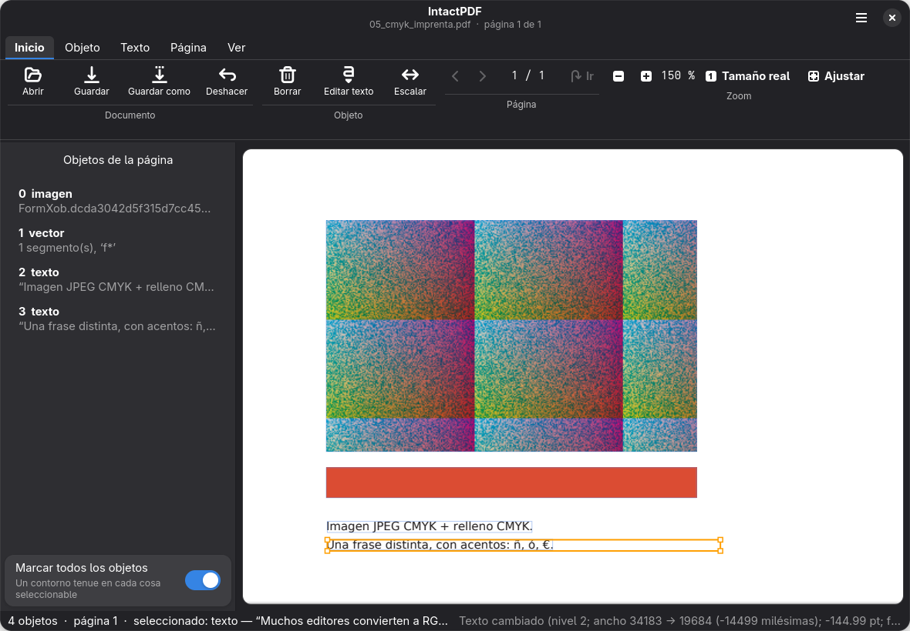
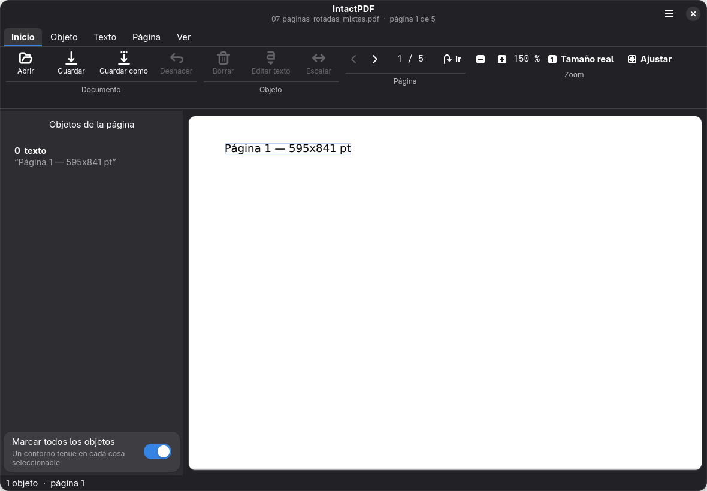

# IntactPDF

<p align="center">
  
</p>

<p align="center">
  <strong>Editor estructural de PDF nativo para Linux diseñado para modificar objetos existentes preservando el 100% del documento original.</strong>
</p>

<p align="center">
  <a href="https://github.com/LockerDocx/intactpdf/actions"></a>
  <a href="LICENSE-MIT"></a>
  <a href="pyproject.toml"></a>
  <a href="gui/ventana.py"></a>
  
  
</p>

---

## 🎯 ¿Por qué existe IntactPDF?

Cuando abres un PDF en **LibreOffice Draw**, **Inkscape** u otros editores convencionales y guardas, ocurre una alteración silenciosa: **el archivo completo es parseado, reinterpretado en un modelo vectorial ajeno y reconstruido desde cero**.

### El coste de la reconstrucción tradicional
* ❌ **Destrucción de perfiles de color:** Espacios CMYK, separación de tintas y perfiles ICC de imprenta se convierten o aplanan a RGB.
* ❌ **Pérdida de metadatos y firmas:** Se descartan formularios AcroForm, firmas electrónicas, capas de contenido opcional (OCG) y marcas de recorte.
* ❌ **Descalibre tipográfico:** Fuentes incrustadas o subconjuntos (*font subsets*) se descomponen o sustituyen por fuentes del sistema, alterando el espaciado entre caracteres.
* ❌ **Ruido visual comprobado:** Un PDF abierto y guardado en LibreOffice Draw sin realizar ningún cambio altera empíricamente entre el **0.4% y el 11.8% de los píxeles** de cada página.

### El Principio IntactPDF

> **«Modifica con precisión quirúrgica el objeto seleccionado. Preserva intactos todos los demás bytes del documento original.»**

```
PDF Original
┌────────────────────────────────────────────────────────┐
│  Cabecera, Metadatos, Fuentes incrustadas, Formulario  │
│  Streams de contenido, Imágenes, Estructuras complejas │
└────────────────────────────────────────────────────────┘
                           ▼
Guardado Incremental IntactPDF (ISO 32000-1 §7.5.6)
┌────────────────────────────────────────────────────────┐
│  Bytes originales íntegros (100% prefijo inalterado)   │
├────────────────────────────────────────────────────────┤
│  + Nuevos objetos o revisiones quirúrgicas             │
│  + Tabla de referencias cruzadas incremental (xref)    │
│  + Nuevo trailer con puntero /Prev a la revisión previa│
└────────────────────────────────────────────────────────┘
```

---

## ⚖️ Comparativa Técnica con Otros Editores

| Característica | LibreOffice Draw | Inkscape | Adobe Acrobat | **IntactPDF** |
| :--- | :---: | :---: | :---: | :---: |
| **Arquitectura de guardado** | Reconstrucción total | Reconstrucción SVG | Incremental (propietario) | **Incremental estricto (ISO)** |
| **Prefijo de bytes original** | 0% (se destruye) | 0% (se destruye) | Parcial / Variable | **100% idéntico verificado** |
| **Preservación CMYK / Imprenta** | ❌ Convierte a RGB | ❌ Parcial | ✅ Sí | ✅ **Preservación total** |
| **Edición localizada sin reflow** | ❌ Reorganiza cajas | ❌ Reorganiza | ✅ Sí | ✅ **Sí (ajuste métrico Tc)** |
| **Sustitución in situ de imágenes** | ❌ Recomprime página | ❌ Recomprime | ✅ Sí | ✅ **In-place en XObject** |
| **Rotación sin recomprimir** | ❌ Recompone | ❌ Recompone | ✅ Sí | ✅ **Actualización /Rotate** |
| **Uso de recursos y dependencias** | Pesado (suite) | Pesado | De pago / No Linux | **Ligero / GTK4 nativo Linux** |
| **Uso en scripts / automatización (CLI)**| ❌ No | Limitado | ❌ No nativo en Linux | ✅ **CLI completo integrado** |

---

## 📸 Galería de la Interfaz Gráfica (GTK4 + Libadwaita)

IntactPDF ofrece una experiencia de escritorio moderna, perfectamente integrada en GNOME y escritorios Linux compatibles con temas claros y oscuros.

### 1. Vista General e Inspección de Objetos
La interfaz organiza el documento en una vista central de alta fidelidad (`pdfium`) con un panel lateral que lista todos los objetos vectoriales, imágenes y bloques de texto identificados:

| Vista Inicial de Lectura | Inspección y Selección de Objeto |
| :---: | :---: |
|  |  |

---

### 2. Cinta de Opciones Contextual
La barra superior organiza las herramientas por categorías especializadas, activando o desactivando controles según el tipo de objeto seleccionado:

| Pestaña Objeto (Mover, Escalar, Reemplazar Imagen) | Pestaña Texto (Edición con preservación tipográfica) |
| :---: | :---: |
|  |  |

| Pestaña Página (Rotación incremental 90°/180°/270°) | Pestaña Ver (Zoom continuo y ajuste de página) |
| :---: | :---: |
|  |  |

---

### 3. Edición en Vivo y Rotación
Previsualiza de forma instantánea cualquier modificación de texto o rotación antes de confirmar el guardado:

| Previsualización de Texto Modificado | Rotación de Páginas con Miniaturas |
| :---: | :---: |
|  |  |

---

## ⚡ Capacidades y Características

### 🔤 Edición Tipográfica de Texto
* **Reemplazo directo de bytes:** Si la nueva cadena coincide en longitud y codificación con la original, se actualiza directamente sin añadir un solo byte adicional.
* **Ajuste métrico de espaciado (`Tc`):** Para textos con ligeras variaciones de longitud, se compensa el espaciado entre glifos para evitar desbordamientos visuales sin romper la alineación de la línea.
* **Incrustación de subconjuntos:** Soporte para insertar nuevos caracteres conservando el estilo y métrica de las fuentes originales.

### 🖼️ Manipulación Completa de Imágenes
* **Reemplazo de imagen (`replace-image`):** Permite cambiar cualquier imagen, logotipo o firma por un nuevo archivo (PNG, JPEG, WebP) conservando exactamente la posición, matriz de transformación y dimensiones del objeto original en la página.
* **Extracción de imagen (`extract-image`):** Exporta imágenes incrustadas a disco en su formato y resolución nativos sin recomprimir ni perder calidad.

### 📐 Transformaciones Geométricas
* **Desplazamiento y arrastre:** Mueve objetos mediante coordenadas en puntos tipográficos (`pt`) o de forma interactiva con el ratón.
* **Escalado proporcional:** Escala ilustraciones o bloques vectoriales preservando el estado gráfico posterior del PDF.

### 🔄 Rotación de Páginas
* **Rotación limpia en 90°, 180° o 270°:** Modifica únicamente el diccionario `/Rotate` de la página especificada en la revisión incremental, sin descomprimir ni reinterpretar los streams de contenido.

### 🛡️ Seguridad Legal y Calidad de Guardado
* **Alerta visual de firmas digitales:** Si el PDF contiene firmas electrónicas criptográficas (`/Sig`, `/ByteRange`, `/AcroForm`), IntactPDF muestra una advertencia visible (`Adw.Banner`) alertando de que modificar el documento puede invalidar la validez jurídica de las firmas existentes.
* **Guardado sobre el original con respaldo:** Guarda directamente sobre el archivo original de forma atómica (usando un archivo temporal `staging`) y genera automáticamente una copia de seguridad `archivo.pdf~`.
* **Compactación / Redacción segura (`compact`):** Al ser incremental, los objetos eliminados residen en las revisiones anteriores del binario. El comando `compact` purga irreversiblemente el historial y reescribe solo los objetos activos cuando se necesita privacidad absoluta.
* **Descifrado (`decrypt`):** Permite remover restricciones de contraseñas de lectura conocidas antes de iniciar una sesión de edición.

### 🖱️ Ergonomía y Atajos
* **Zoom continuo:** `Ctrl + Rueda del ratón` o mediante `Ctrl + +`, `Ctrl + -` y `Ctrl + 0` (ajuste a la ventana).
* **Copiar al portapapeles:** `Ctrl + C` copia directamente el contenido del bloque de texto seleccionado.
* **Historial completo:** `Ctrl + Z` para Deshacer y `Ctrl + Shift + Z` (o `Ctrl + Y`) para Rehacer.

---

## 🏛️ Arquitectura del Sistema

```
                      ┌────────────────────────┐
                      │     IntactPDF GUI      │  (GTK4 + Libadwaita)
                      │    (gui/ventana.py)    │
                      └───────────┬────────────┘
                                  │
┌────────────────────────┐        │        ┌────────────────────────┐
│     IntactPDF CLI      ├────────┼────────┤    Python API / SDK    │
│    (nucleo/cli.py)     │        │        │   (nucleo/editar.py)   │
└───────────┬────────────┘        │        └───────────┬────────────┘
            │                     │                    │
            └─────────────────────┼────────────────────┘
                                  ▼
           ┌──────────────────────────────────────────────┐
           │             NÚCLEO ESTRUCTURAL               │
           ├──────────────────────┬───────────────────────┤
           │  nucleo/parser.py    │  nucleo/geometria.py  │
           │  nucleo/objetos.py   │  nucleo/fuentes.py    │
           │  nucleo/alinear.py   │  nucleo/editar_txt.py │
           └──────────────────────┴───────────────────────┘
                                  │
                                  ▼
           ┌──────────────────────────────────────────────┐
           │      GUARDADO INCREMENTAL & VALIDACIÓN       │
           ├──────────────────────────────────────────────┤
           │  nucleo/guardar.py                           │
           │  - Escritura incremental ISO 32000-1         │
           │  - Staging atómico + backup .pdf~            │
           │  - Verificación visual de tinta (pdfium)     │
           │  - Validación de prefijo binario             │
           └──────────────────────────────────────────────┘
```

---

## 🚀 Instalación y Uso

### 📦 Opción 1: Instalación sin permisos de root (Recomendado)

Ideal para cualquier usuario en **openSUSE Leap / Tumbleweed**, **Fedora**, **Ubuntu**, **Debian**, **Arch Linux** o entornos corporativos donde no tienes acceso a `root` / `sudo`:

```bash
# 1. Clonar el repositorio
git clone https://github.com/LockerDocx/intactpdf.git
cd intactpdf

# 2. Crear entorno virtual de usuario con acceso a las librerías del sistema
python3 -m venv ~/.local/share/intactpdf-env --system-site-packages

# 3. Instalar el paquete en modo editable
~/.local/share/intactpdf-env/bin/pip install -e .

# 4. Añadir al PATH de tu usuario (si no lo tienes ya)
echo 'export PATH="$HOME/.local/share/intactpdf-env/bin:$PATH"' >> ~/.bashrc
source ~/.bashrc

# 5. ¡Listo! Puedes lanzar la interfaz o usar el CLI:
intactpdf-gui            # Abre la interfaz gráfica
intactpdf info test.pdf  # Inspecciona un PDF desde la terminal
```

> **Nota para openSUSE:** Si el sistema ya cuenta con los paquetes gráficos habituales (`python3-gobject`, `typelib-1_0-Gtk-4_0`, `typelib-1_0-Adw-1`), `intactpdf-gui` arrancará de forma inmediata. Si estás en un sistema mínimo de solo consola, el comando `intactpdf` funciona al 100% sin necesidad de interfaz gráfica.

---

### 📦 Opción 2: Paquete Flatpak (Aislamiento Total)

Si prefieres usar Flatpak:

```bash
# Compilar e instalar a nivel de usuario (sin root)
flatpak-builder --user --install --force-clean \
    build-dir packaging/io.github.lockerdocx.IntactPDF.json

# Ejecutar
flatpak run io.github.lockerdocx.IntactPDF
```

---

### 📦 Opción 3: Script Automatizado `instalar.sh`

```bash
git clone https://github.com/LockerDocx/intactpdf.git
cd intactpdf
./instalar.sh
```

El script detecta automáticamente tu distribución Linux, comprueba las dependencias disponibles y configura el entorno óptimo.

---

## 💻 Referencia de la Línea de Comandos (CLI)

IntactPDF incluye herramientas de terminal para automatizar modificaciones por lotes en entornos de servidor:

| Comando | Descripción | Ejemplo de Uso |
| :--- | :--- | :--- |
| `doctor` | Diagnostica dependencias y estado del entorno | `intactpdf doctor` |
| `info` | Inspecciona metadatos, revisiones y firmas | `intactpdf info documento.pdf` |
| `list` | Lista todos los objetos de una página con coordenadas | `intactpdf list doc.pdf --pagina 0` |
| `fonts` | Inspecciona fuentes y tipografías incrustadas | `intactpdf fonts documento.pdf` |
| `edit` | Modifica texto de un objeto específico | `intactpdf edit doc.pdf --object 2 --text "Nuevo Texto" -o salida.pdf` |
| `replace-image` | Sustituye un XObject de imagen conservando el layout | `intactpdf replace-image doc.pdf --xobject Im1 --imagen logo.png -o salida.pdf` |
| `extract-image` | Extrae una imagen incrustada a disco | `intactpdf extract-image doc.pdf --xobject Im1 -o logo.png` |
| `rotate` | Rota una página (90, 180, 270 grados) | `intactpdf rotate doc.pdf --pagina 0 --angulo 90 -o rotado.pdf` |
| `delete` | Elimina un objeto de la página | `intactpdf delete doc.pdf --object 5 -o limpio.pdf` |
| `move` | Desplaza un objeto en coordenadas X/Y (pt) | `intactpdf move doc.pdf --object 3 --dx 10 --dy -5 -o movido.pdf` |
| `scale` | Escala un objeto proporcionalmente | `intactpdf scale doc.pdf --object 3 --factor 1.2 -o escalado.pdf` |
| `compact` | Purga el historial previo y revisiones antiguas | `intactpdf compact editado.pdf -o final_seguro.pdf` |
| `decrypt` | Descifra un documento protegido con contraseña | `intactpdf decrypt cifrado.pdf -p "clave" -o abierto.pdf` |
| `check` | Valida la integridad estructural del PDF | `intactpdf check salida.pdf` |

> 💡 **Guardado In-Place:** En los comandos de modificación (`edit`, `delete`, `move`, `scale`, `replace-image`, `rotate`), puedes usar el modificador `--in-place` para aplicar los cambios directamente sobre el archivo original, generando un respaldo automático `.pdf~`.

---

## 🧪 Pruebas Automatizadas y Calidad

El proyecto cuenta con una infraestructura de pruebas rigurosa que valida tanto la integridad estructural del código como la fidelidad visual:

```bash
# 1. Ejecutar las 118 pruebas unitarias
pytest tests/ -v

# 2. Ejecutar la validación visual sobre el corpus dorado de PDFs reales
python3 tools/test_aceptacion.py
```

### Resultados de la Suite
* **118 pruebas unitarias aprobadas**, 0 fallos, 4 omitidas (artefactos opcionales de release).
* **19 de 19 pruebas de aceptación visual (100% de éxito):** 0 píxeles alterados fuera de la región editada respecto al documento original.
* **Preservación de prefijo (19/19):** Verificación matemática de que los bytes del documento original permanecen inalterados en la cabecera del archivo generado.

---

## 🗺️ Hoja de Ruta

- [x] Motor de guardado incremental estricto (ISO 32000-1 §7.5.6)
- [x] Soporte de edición tipográfica con ajuste métrico `Tc`
- [x] Interfaz GTK4 + Libadwaita con cinta de opciones contextual
- [x] Reemplazo y extracción de imágenes (`replace-image`, `extract-image`)
- [x] Rotación incremental de páginas (`rotate`)
- [x] Detección visual de firmas digitales
- [x] Herramienta de compactación de revisiones (`compact`)
- [x] Atajos ergonómicos (Ctrl+C, Ctrl+Scroll, Undo/Redo)
- [x] Guardado atómico sobre el archivo original con backup automático
- [ ] Soporte para alfabetos de derecha a izquierda (RTL: Árabe, Hebreo)
- [ ] Edición de bloques de texto multilínea con justificación dinámica (reflow)
- [ ] Publicación del paquete en el catálogo central de Flathub

---

## 📄 Licencia

Este proyecto está disponible bajo doble licencia:
* [MIT License](LICENSE-MIT)
* [Apache License, Version 2.0](LICENSE-APACHE)

Puedes elegir cualquiera de las dos licencias a tu conveniencia.
